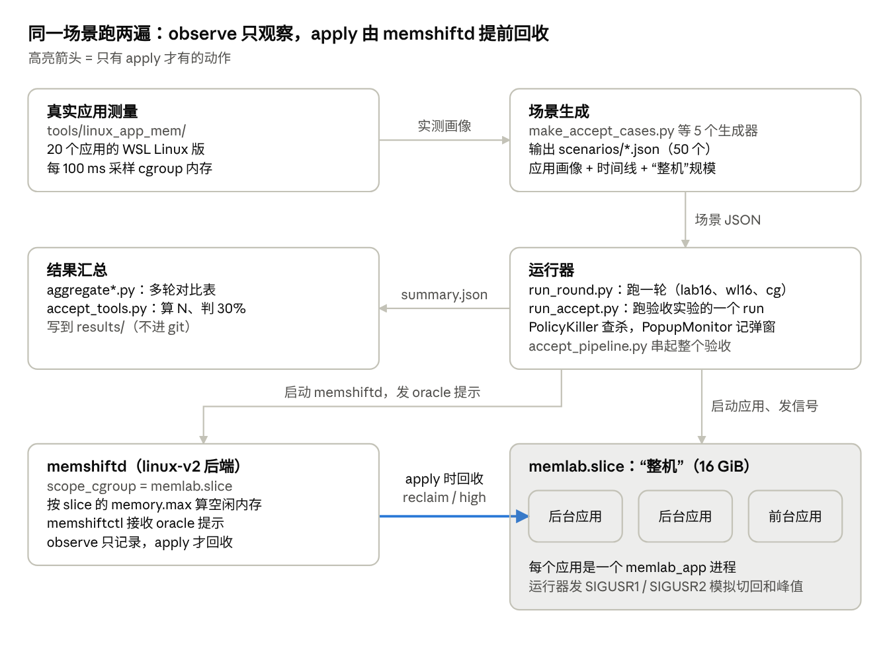

# linux-oom-lab 新代码结构说明

2026-10-27 · Boyi

本文说明 `linux-oom-lab` 分支上新写的代码。它基于 `main` 的 b2ed062，共 16 个提交（2026-10-18 至 10-25），改动 130 个文件：约 1.57 万行代码，另有 50 个场景 JSON（约 9.4 万行）。这些提交目前只在本地，没有推送到 GitHub。

新代码分三块：

1. **memshiftd 改动**（1,547 行）：让 linux-v2 后端把一个 cgroup 当作“整机”，并能用 memory.high 脉冲施加回收。
2. **linux_lab 实验框架**（7,700 行 + 50 个场景）：在 WSL 上用合成负载复现内存不足场景，对比 observe（只观察，基线）和 apply（提前回收，优化）。
3. **tools/linux_app_mem 应用测量工具**（6,452 行）：测量 20 个白名单应用（Linux 版或同类替代）的真实内存，给场景提供参数。

鸿蒙后端只改了 1 行（GCC 13 编译修复），设备上的运行路径不受影响。所有实验数字都来自 WSL 上的 Linux 环境，不是鸿蒙设备实测。下文路径中的 `MS/` 指 `常驻服务代码/memshift_cpp/memshift_cpp/`。

## 总体结构



运行器在 observe 和 apply 下用同一场景、同样的 oracle 提示，区别只在 memshiftd 是否真的回收；然后对比两者的弹窗、查杀、OOM 和启动失败次数。lab16、wl16 的 apply 写 memory.reclaim，cg 和验收实验写 memory.high。

## 文件分布

代码量主要在 linux_lab 的 Python 脚本和应用操作脚本；场景 JSON 是生成的，行数多但不用读。

| 位置 | 文件数 | 新增行数 | 内容 |
| --- | --- | --- | --- |
| `MS/src/` | 7 | 1,157（删 25） | memshiftd 的 scope 模式、high 模式、cgroup 读写 |
| `MS/tests/` | 2 | 383 | scope 换算和水位线算法的单元测试 |
| `MS/CMakeLists.txt` | 1 | 7 | 加入 memlab_app 和两个测试目标 |
| `MS/linux_lab/*.py` | 13 | 6,892 | 单轮运行、场景生成、验收流程、汇总 |
| `MS/linux_lab/memlab_app.cpp` | 1 | 634 | 合成“应用”负载 |
| `MS/linux_lab/run_*.sh` | 5 | 174 | 各场景的正式运行脚本 |
| `MS/linux_lab/scenarios/` | 50 | 94,191 | 场景定义 JSON（生成物） |
| `tools/linux_app_mem/*_trial.py` | 17 | 3,468 | 每个应用一份操作脚本 |
| `tools/linux_app_mem/make_*.py` | 7 | 561 | 生成测试素材（文档、邮件、音乐等） |
| `tools/linux_app_mem/` 报表类 | 10 | 1,154 | 汇总表、WSS 表、场景求和 |
| `tools/linux_app_mem/` 其他 | 17 | 1,269 | 测量核心 appmem.py、公共函数、队列脚本 |

实验结果在 `results/` 下，该目录被 .gitignore 忽略，不在提交里。

## memshiftd 的改动

memshiftd 新增两个只属于 linux-v2 后端的模式：**scope 模式**（把一个 cgroup 当作整机）和 **high 模式**（用 memory.high 脉冲回收）。两者都要在配置里显式打开，不配置时行为与 b2ed062 相同。

| 文件 | 改了什么 |
| --- | --- |
| `src/linux_scope.hpp`（新，79 行） | scope 模式。把 `scope_cgroup` 的 memory.max 当作物理内存，从它的 memory.current / stat / swap / pressure 推出 total、free、available、swap 和 PSI，代替 /proc/meminfo。入口 `machineSample()`；`validateScopeTargets()` 要求所有应用都在 scope 内 |
| `src/watermark.hpp`（新，280 行） | high 模式的纯算法，不碰 cgroup，方便测试：水位线 `watermarks()`、剩余峰值 `remainingPeak()`、保留底线 `residentFloor()`、单次脉冲上限 `pulseLimit()`、zswap 配额 `planZswapQuotas()`、PSI 窗口与刹车、TMO 步长 `tmoStep()` / `tmoEvaluate()` |
| `src/memshiftd.cpp`（+626） | `runHigh()` 主循环和后台线程 `PulseWorker`；`run()` 在 `reclaim_interface=high` 时转入 `runHigh()`；linux-v2 的采样一律改用 `machineSample()`；提示量按 `boostCap()` 截断 |
| `src/core.hpp`（+45） | `Options` 新字段（scope、水位线、脉冲、TMO、刹车等）；采样新字段 zswap / zswapped / highEvents；`boostCap()` |
| `src/io.hpp`（+113 / −3） | 新配置键的解析和校验；控制文件新增峰值目标和峰值时刻（`parsePeakTargets()`、`applyHint()`） |
| `src/memshiftctl.cpp`（+13 / −7） | 新参数 `--peak-targets name:MiB,...` 和 `--peak-at-unix`，只能与 `--boost-mb` 一起给 |
| `src/harmony_v1.cpp`（1 行） | GCC 13 编译修复（`duration_cast` 的目标类型） |
| `tests/test_linux_scope.cpp`、`tests/test_watermark.cpp` | 单元测试，已接入 ctest（`linux_scope`、`watermark`） |

### high 模式怎么工作

high 模式用 memory.high **脉冲**回收后台应用：先把 memory.high 压到当前用量以下，内核在这次写入里同步回收，然后立刻恢复成 max。它要求同时配置 `scope_cgroup`。

**一次脉冲**（`PulseWorker::pulse()`，在 memshiftd.cpp）

1. 写 `memory.high = current − N`，N 每次最多 `pulse_mb`（默认 256 MiB，验收配置 16 MiB）。
2. 内核在这次 write 调用里同步回收，回收完 write 才返回。
3. 立刻写回 `memory.high = max`；出错或异常时也会写回。

一个回收任务由若干脉冲组成。后台线程 `PulseWorker` 一次只跑一个任务，脉冲之间按 `pulse_rate_mb_s` 限速。达到目标、碰到底线、内核没有进展或超过 `pulse_timeout_ms` 时，任务结束。

所以应用只是被挤一下，之后可以照常增长，不会一直顶着上限。这与 TMO 的用户态代理 Senpai 不同：Senpai 把 memory.high 持续压在用量下方，并按 PSI 逐步下调。这里不这样做，是因为 10-22 的试验（`results/memhigh_probe_20261022/记录.md`）发现：memory.high 一直压低时，应用自己申请内存会被卡住（申请 512 MiB 在 60 秒内没有完成）；而且内核不会在后台继续回收，只会在写入时或应用申请内存时回收。

**每次挤谁、挤多少**

只挤后台应用，按应用的 `priority` 从最可牺牲的开始（实验里传入 oom_adj）；每个应用至少保留 `floor_ratio`（默认 20%）的内存；被 `memshiftctl --protect` 保护的应用不挤。主循环每个 tick 最多发起一个任务，按下表顺序选触发：

| 顺序 | 触发 | 默认 | 规则 |
| --- | --- | --- | --- |
| 1 | 低水位 | 开 | scope 空闲内存低于 `wm_low_mb`（512）时开始，挤到空闲回到 `wm_high_mb`（1024），仿鸿蒙 zswapd。默认 `hint_mode=watermark` 时，oracle 提示会把高水位抬到“尚未到来的峰值内存 + `hint_reserve_mb`” |
| 2 | rate 提示（`hint_mode=rate`） | 关 | 收到带 `peak_at_unix` 的 oracle 提示后，把缺口（峰值总需求 + `hint_reserve_mb` − 当前空闲）在峰值前 `hint_stop_sec` 秒之前匀速补足 |
| 3 | TMO（`tmo=1`） | 关 | 每 `tmo_interval_ms` 看每个后台应用自己的 memory PSI：挤 `tmo_ratio` × 底线以上的空间 × (1 − PSI / `tmo_psi_target_us`)，至少 `tmo_min_step_mb`；PSI 达到目标就暂停 `tmo_backoff_sec` |

另有两个可选功能，默认关：

- 刹车：scope 过去 1 秒的 PSI some 达到 `brake_some_ms` 时暂停所有脉冲；同一任务中，上一脉冲以来 scope 的卡顿增加了 `brake_pulse_ms` 就结束该任务。
- `zswap_quota=1`：用每个应用的 memory.zswap.max 把一部分匿名页直接送到磁盘 swap。

**验收实验实际用的配置**（`acceptS130.json` 的 memshiftd 段）

`reclaim_interface=high`；`tmo=true`（`tmo_interval_ms=2000`、`tmo_ratio=0.25`、`tmo_psi_target_us=2000`、`tmo_backoff_sec=10`）；`hint_mode=rate`（`hint_stop_sec=5`）；`pulse_mb=16`、`pulse_rate_mb_s=256`；`brake_some_ms=20`、`brake_pulse_ms=5`；`floor_ratio=0.2`；tick 间隔 250 ms。

三次优化运行里，约 92% 的回收量来自 rate 提示，8–9% 来自 TMO，低水位没有触发。也就是说，验收结果主要靠“提前知道峰值、按匀速挤后台应用”。下表按各运行的 `memshiftd/reclaim.csv` 统计，回收量 = 各任务 `current_change` 的合计。

| 运行 | rate 提示：任务数 / 回收量 | TMO：任务数 / 回收量 | 低水位 |
| --- | --- | --- | --- |
| formal_tmoh_1 | 1,573 / 172,526 MiB（92%） | 295 / 15,095 MiB（8%） | 0 |
| formal_tmoh_2 | 1,604 / 173,887 MiB（92%） | 283 / 15,726 MiB（8%） | 0 |
| formal_tmoh_3 | 1,485 / 169,559 MiB（91%） | 299 / 16,901 MiB（9%） | 0 |

high 模式的日志写在配置项 `log_dir` 指定的目录：`reclaim.csv` 与原来的 reclaim 模式列相同（run_round.py 依赖它），另加 `pulses.csv`（每次脉冲）、`brake.csv`（刹车区间）和 `quota.csv`（zswap 配额）。

## linux_lab 基础框架

linux_lab 用一个 systemd 用户 slice（`memlab.slice`）充当整机：它的 MemoryMax 就是“物理内存”，MemorySwapMax 是 swap 预算。每个模拟应用是一个 `memlab_app` 进程，跑在自己的 `memlab-<name>.service` 里。运行不需要 sudo。

| 文件 | 作用 |
| --- | --- |
| `memlab_app.cpp` | 一个模拟应用。日常内存 = 冷匿名页 + 干净页缓存 + 一个持续写脏的文件。SIGUSR1 = 用户切回该应用（重新访问全部日常内存），SIGUSR2 = 一次峰值（再申请 peak_mib，保持 hold_s 后释放）。还能模拟热工作集、实测峰值曲线（`--peak-curve`）、等待启动信号（`--await-start`）等 |
| `run_round.py` | 跑一轮：建 slice、按场景时间线启动应用并发信号、启动 memshiftd（off / observe / apply）、发 oracle 提示、执行查杀策略、记录弹窗，最后写 `summary.json` |
| `make_scenario.py` | 生成最早的 20 应用场景（16 个后台 + 4 个峰值应用） |
| `make_whitelist.py` | 生成白名单并发启动场景 wl16，并逐个 case 检查验收的三个条件 |
| `make_cgroup_scenarios.py` | 用实测应用内存生成对齐峰值场景 cgA–cgE |
| `make_peak_curves.py` | 从应用测量结果里提取 100 ms 峰值曲线，给 `--peak-curve` 用 |
| `calibrate_apps.py` | 单应用校准：每个应用单独跑一遍，量它的日常和峰值内存 |
| `run_series.py` | 交替跑多轮（observe 1、apply 1、observe 2……），让主机漂移对各模式影响相同 |
| `aggregate.py`、`aggregate_aligned.py` | 把各轮 `summary.json` 汇成对比表（Markdown + CSV）；后者专用于 cgA–cgE |
| `run_lab20.sh`、`run_lab16.sh`、`run_wl16.sh`、`run_wl16_ablation.sh`、`run_cg.sh` | 各场景的正式对比和消融实验脚本 |

### 一轮里发生什么

1. `run_round.py --scenario S.json --mode observe|apply --round-id N --out DIR` 创建轮次目录，写入 `scenario.json` 和 `args.json`。
2. 按场景类型执行时间线：`timeline`（launch / peak / return 操作）、`cases`（白名单：一组应用同时点击启动）或 `peak_plan`（cgA–cgE：所有峰值应用在同一时刻到峰）。
3. `--lead` 秒前通过 memshiftctl 发 oracle 提示（即“100% 预测”）。observe 和 apply 收到同样的提示，区别只在是否真的回收；`--error` 可人为加预测误差。
4. 事件统计：内核 OOM 从内核日志读；策略查杀 `PolicyKiller` 仿 lmkd，slice 的 PSI 卡顿超过阈值时杀掉最久未用的后台应用；Linux 没有低内存弹窗，由 `PopupMonitor` 在可用内存低于 `low_mib` 时记一次；启动失败按鸿蒙框架的规则算（启动期间被杀）。
5. 结束后写 `summary.json`，由 aggregate 脚本汇总。

## 验收实验（结构 B）

验收实验对应验收表“内存错峰调度”一行，由 4 个脚本完成，按鸿蒙设备框架的流程走：校准 → 资格运行 → 冻结 N → 正式对比。结果在 `results/linux_oom_lab_accept_20261024/验收结果汇总.md`。

| 文件 | 行数 | 作用 |
| --- | --- | --- |
| `make_accept_cases.py` | 424 | 把阶段 1 选出的 case 序列和各应用实测画像组装成场景 JSON（如 `acceptS130.json`），并检查验收的三个条件（M = 16384 MiB） |
| `run_accept.py` | 2,234 | 跑一个完整的 run：逐个 case 启动一组 7–8 个应用、对齐峰值、统计事件；还负责校准（`--calibrate`）和自测（`--self-test`） |
| `accept_tools.py` | 904 | 离线计算：`qualify` 从资格运行算 N 并写 `freeze.json`；`compare` 对比正式运行、给出是否达到 30% 的结论；`extend` 把冻结扩到 N′ |
| `accept_pipeline.py` | 1,267 | 无人值守的总驱动：按阶段调用上面三个脚本，支持中断后续跑（`pipeline_state.json`），每步写 `进度.md` 并弹 Windows 通知 |

### 一个 case 怎么跑（run_accept.py）

1. 一组 7–8 个 memlab_app 按 `click_gap_s` 依次“点击”启动。最后点的是前台（oom_score_adj 100），其余是后台（900）。
2. 各应用加载日常内存后等待启动信号。所有应用就绪后，runner 安排各应用开始爬升，使它们在同一时刻 T 到峰。
3. 应用开始爬升前先被保护（`memshiftctl --protect`，memory.high 设回 max），避免被回收。
4. oracle 提示在第一次点击前 `hint_lead_s` 秒发出，内容是该 case 的同时刻总量、各应用目标和计划的 T。
5. 应用保持、释放、退出后，runner 删掉它们的数据文件（清页缓存），确认 slice 已空，再跑下一个 case。

事件分四类：弹窗、策略查杀（70 ms / 700 ms 两级）、内核 OOM、启动失败。归因逻辑都在纯函数 `analyze()` 及其辅助函数里，可用 `--self-test` 验证。每个 run 目录含 `cases.csv`、`attempts.csv`、`events.csv`、`pressure.csv`（10 Hz）、`summary.json` 和 memshiftd 日志。

### 总流程（accept_pipeline.py）

1. `checks`：编译、跑 ctest，再用调试 case 试跑 observe 和 apply。
2. `calibrate`：单应用校准，用校准值重新生成场景（`<name>_cal.json`）。
3. `qualify`：用 observe 跑完整个候选序列，`accept_tools.py qualify` 算出 N 并冻结。
4. `smoke`：确认 apply 下 memshiftd 确实提交了回收任务。
5. `formal`：在前 N 个 case 上交替跑 3 次 observe（基线）和 3 次 apply + 提示（优化）；代码也支持不带提示的 apply 运行。无效的 run 立即重跑。
6. `report`：`accept_tools.py compare` 写 `report.md` / `report.json`。
7. `reference`（可选）：在未筛选的 20 个参考 case（R20）上各跑 1 次，只作参考。

## 场景文件

`linux_lab/scenarios/` 里的 50 个 JSON 都是生成器的输出（smoke6 除外），按时间先后分六系列。现在的主线是 acceptS130。

| 系列 | 文件 | 生成器 | “整机”内存 / swap / zswap | 用途 |
| --- | --- | --- | --- | --- |
| 验收 | `acceptS130.json` | make_accept_cases.py | 16 / 25 / 2 GiB | 验收实验主场景：16 个应用，72 个正式 case + 调试 case |
| 对齐峰值 | `cgA`–`cgE` 及变体，共 34 个 | make_cgroup_scenarios.py | 16 / 25 / 2 GiB | 用实测应用内存搭 5 个场景（A 办公+创作、B 浏览器+创作、C 多标签+办公、D 影音+创作、E 后台导出+前台操作） |
| 峰值曲线 | `peak_curves.json` | make_peak_curves.py | — | `*_curve_k70` 场景引用的实测 100 ms 曲线 |
| 白名单 | `wl16`、`wl16g6`、`wl16g55`、`wl16_nominal` | make_whitelist.py | 16 / 25 / 2–4 GiB | 20 个白名单应用（画像是按类别估的），每个 case 同时点开 6 个应用；g6 / g55 是 6 s / 5.5 s 点击间隔的校准版，nominal 是未校准、2 s 间隔的版本 |
| 16 GiB 合成 | `lab16`、`c16b`、`c16c` | make_scenario.py | 16 / 25 / 4 GiB | 20 个合成应用；lab16 = c16c（2×3600 MiB 峰值），c16b 是 2880 MiB 的校准版 |
| 5 GiB 合成 | `lab20`、`quick`、`cal01`–`cal04` | make_scenario.py | 5 GiB / 1.75–6 GiB / 无 | 最早的小规模版本，结果已被 16 GiB 版取代 |
| 流程自检 | `smoke6.json` | 手写 | 2 / 2 GiB | 6 个应用的连通性检查 |

cg 变体的后缀对应生成器参数：`_hot` = 后台应用有热工作集（`--hot-set wss`），`_hotall` = 所有应用都有（`wss_all`），`_r10` / `_r20` = 峰值在 10 / 20 秒内爬完（`--ramp-cap`），`_d50all` = 所有应用 50% 文件页为脏页，`_curve_k70` = 按实测曲线爬升且查杀阈值 70 ms。

## 真实应用内存测量

`tools/linux_app_mem/` 在 WSL 上测白名单应用的 Linux 版（20 个：6 个官方 Linux 版 + 14 个同类替代；B站、抖音用 Chrome 网页版，小红书登录失败后换成 Imgur）。测得的 cgroup 内存用于生成 cg 和验收场景。这些数字是“WSL 上 Linux 版实测，非鸿蒙”，结果在 `results/linux_app_mem_20261021/`。

| 类别 | 文件 | 作用 |
| --- | --- | --- |
| 测量核心 | `appmem.py` | 在 `appmem.slice`（MemoryMax 16G、swap 25G、zswap 2G）下为应用开独立 scope，每 100 ms 采样 memory.stat，打阶段标记、截窗口图；`APPMEM_WSS=1` 时还记 RSS / PSS / WSS |
| 公共流程 | `trial_common.py` | 每个操作一次冷启动：清文件缓存、在 Xvfb 虚拟屏上启动、等 CPU 空闲、停止前记 `mapped_files.json` |
| 应用操作脚本 | 17 个 `*_trial.py` | 每个应用一份，用 xdotool 或 Chrome DevTools 按固定步骤操作（S01 启动、S02 日常、之后为各种峰值操作和后台）。官方版：WPS、微信、飞书、钉钉、MindMaster、EdrawMax；替代：Chrome / Edge（`browser_trial`）、网页版（`web_trial`）、Shotcut、GIMP、LibreCAD、Thunderbird、Evolution、VLC、Rhythmbox、Gnote、GNOME 日历 |
| 素材生成 | 7 个 `make_*.py` | 用固定种子生成测试文档、邮件、日历、笔记、音乐、DXF 图纸和 Shotcut 工程，保证每次重跑内容相同 |
| 单应用报表 | `report.py`、`report_session.py`、`report_wss.py`、`report_wss10.py`、`doc_tables.py` | 把一个应用的采样整理成 `table.md` / `table.csv`：峰值时刻的 anon / file / shmem / kernel 拆分，以及 WSS |
| 跨应用汇总 | `cgroup_wss_summary.py`、`rss_wss_summary.py`、`doc_summary.py` | 20 个应用一张总表；实验用 cgroup 版本（RSS 会把多进程共享页重复计算） |
| 场景求和 | `scenario_sum.py`、`scenario_table.py`、`residency.py` | 多个应用同时打开时的总内存，共享系统文件（库、字体、图标）只算一次 |
| 辅助 | `cdp.py`、`xclose.py`、`notify_windows.py`、`running.py`、`stop_test.py`、`stop_queue_after.py`、`xhs_login.py` | DevTools 客户端、优雅关闭 X 窗口、Windows 通知、进程检查和停止、小红书扫码登录（后来放弃） |
| 队列脚本 | `run_formal.sh` 等 8 个 `.sh` | 正式测量队列（每个应用 3 次）、重测、固定 10 s 窗口 WSS 重测及其清理 |

一次测量的顺序：`run_formal.sh` 调用 `<app>_trial.py` → `trial_common` 清缓存并通过 `appmem.py` 启动应用 → 脚本逐步操作并打标记 → 停止应用 → `report*.py` 出表。

## 构建与运行

在 `MS/` 下用 CMake 编译，产物在 `MS/build/`；linux_lab 脚本直接调用那里的 memshiftd、memshiftctl 和 memlab_app。

```bash
cd 常驻服务代码/memshift_cpp/memshift_cpp
cmake -S . -B build
cmake --build build -j4
ctest --test-dir build -R 'watermark|linux_scope|policy|smoke' --output-on-failure
```

不带 `-R` 时，`harmony_v1_profile` 在主机上会失败，因为它的自测要调用设备上才有的 `/system/bin/sh`。

**环境要求**

- WSL 内核要带 zswap：用的是自编的 6.18.54.1，做法见 `results/linux_oom_lab_16g_20261019/calibration/校准记录.md`。
- WSL 的内存要足够让 16 GiB 的 slice 真正用满；`run_accept.py` 在 MemFree 低于 17 GiB 时拒绝开始。
- 用户级 systemd 已委派 memory 控制器，所以实验不需要 sudo。
- 应用测量跑在 Xvfb 虚拟屏 `:99` 上，需要 xdotool、ImageMagick，以及各应用的 Linux 版。
- 实验期间不要在同一台机器上编译或跑其他重负载：主机层面的回收会抢走 slice 的页，让这一轮无效。

**典型命令**（在 `MS/linux_lab/` 下）

```bash
# 单轮：observe 基线，30 s 前发 oracle 提示
python3 run_round.py --scenario scenarios/lab16.json --mode observe --round-id 1 --out OUT --lead 30

# 交替多轮：observe / apply 各 10 轮
python3 run_series.py --scenario scenarios/wl16.json --out OUT/formal --label formal --rounds 10 \
    --variant observe::30 --variant apply::30

# 验收实验全流程（先用 --dry-run 看会执行什么）
python3 accept_pipeline.py --scenario scenarios/acceptS130.json --out OUT --deadline 2026-10-25T19:00 --dry-run
```

应用测量用 `tools/linux_app_mem/run_formal.sh APP ...`，每个应用跑 3 次。

## 建议阅读顺序

先看“整机”怎么定义，再看回收怎么做，最后看实验怎么跑。每个脚本开头都有英文说明，先读说明再读代码。

1. `results/linux_oom_lab_accept_20261024/验收结果汇总.md`：先了解实验做成了什么。
2. `MS/src/linux_scope.hpp`（79 行）：一个 cgroup 怎么变成“整机”。
3. `MS/src/watermark.hpp`，再看 `MS/src/memshiftd.cpp` 里的 `PulseWorker` 和 `runHigh()`：high 模式的算法和执行。
4. `MS/linux_lab/memlab_app.cpp` 开头的注释：模拟应用有哪些行为。
5. `MS/linux_lab/run_round.py`：重点看 `PolicyKiller`、`PopupMonitor` 和 `main()`。
6. `MS/linux_lab/run_accept.py`：重点看 case 调度和 `analyze()`。
7. `MS/linux_lab/accept_tools.py`：`qualify` 和 `compare` 的计算口径。
8. `tools/linux_app_mem/appmem.py`、`trial_common.py`，再挑一个操作脚本（如 `wps_trial.py`）。

## 提交记录

| 日期 | 提交 | 内容 |
| --- | --- | --- |
| 10-25 | 1aa5c3a | 验收实验（结构 B）：run_accept、make_accept_cases、accept_tools、accept_pipeline；memlab_app 加 `--await-start` 等；high 模式加 TMO、rate 提示和刹车 |
| 10-24 | fdf8ed2 | cg16 实验（make_cgroup_scenarios、make_peak_curves、run_cg.sh、aggregate_aligned）；memshiftd high 模式；tools/linux_app_mem 全部工具 |
| 10-19 | 8c93908 | 保留白名单校准场景（6 s / 5.5 s 点击间隔） |
| 10-19 | 916dd91 | 把 wl16 定为校准后的白名单场景（5.5 s） |
| 10-19 | 9147c0e | 白名单正式运行脚本 run_wl16.sh |
| 10-19 | 4655afa | 白名单并发启动场景（make_whitelist、calibrate_apps）；可选提示上限 `boost_cap_fraction` |
| 10-19 | a636f86 | 把 lab16 定为 16 GiB 校准场景（2×3600 MiB 峰值） |
| 10-19 | 57f18a7 | 16 GiB 运行脚本 run_lab16.sh；消融轮次按 round id 配对 |
| 10-19 | 7f50f8e | 场景生成器的 `--scale` 同时缩放 memshiftd 预留 |
| 10-19 | 9f7cc07 | / 或 C: 剩余不到 20 GiB 时拒绝开始一轮 |
| 10-19 | 7f85eb9 | 16 GiB 实验准备：可压缩内存、zswap 指标 |
| 10-19 | 9cdc0a8 | lab20 正式场景和弹窗检查场景 |
| 10-18 | 75ee89e | 低内存弹窗替代（PopupMonitor）和 run_lab20.sh |
| 10-18 | ed86059 | 汇总脚本 aggregate、交替运行 run_series、校准场景 |
| 10-18 | ae4fa61 | 负载 memlab_app、单轮运行 run_round、场景生成 make_scenario |
| 10-18 | ccecb6e | linux-v2 的 scope_cgroup 模式；GCC 13 编译修复 |
